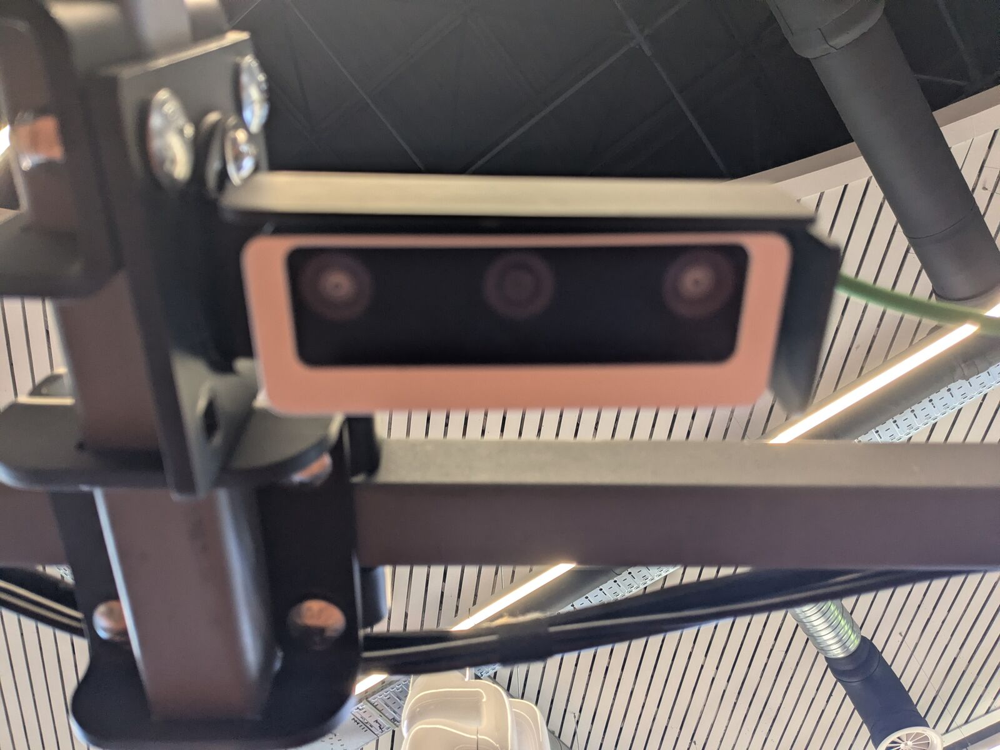

# Camera

The Luxonis OAK-D-W-PoE is mounted on the crossbar and connected to the PoE switch (IP `10.95.76.11`).



## Starting

In the [container](docker.md#entering-the-container):

```bash
ros2 launch depthai_ros_driver camera.launch.py
```

Images are published under `/oak/...`. List them with `ros2 topic list | grep oak`.

## Viewing in RViz

Over RDP, in a second container terminal: `rviz2`. Then **Add**, tab **By topic**, pick the Image under `/oak/rgb/...`.

`Stereo alignment error ... trying to recover` in the log is a depth warning; the colour image is not affected.

## With the robot model

The OAK-D is in the robot model (`camera:=true`; its pose is `camera` in [`arm_platform.yaml`](../src/amiga_arm_description/config/arm_platform.yaml)). Then the robot model publishes the camera's TF frames, so start the driver without its own:

```bash
ros2 launch amiga_arm_description display.launch.py camera:=true use_real_arm:=true
ros2 launch depthai_ros_driver camera_as_part_of_a_robot.launch.py
```

`use_real_arm:=true` takes the arm's joints from its driver; without the xArm driver the arm shows in its zero pose (the camera frames are not affected). Do not combine `camera.launch.py` with `camera:=true`: it runs its own robot_state_publisher and duplicates the TF frames. The simulated OAK-D publishes the same topics, see [Simulation](simulation.md#camera).
