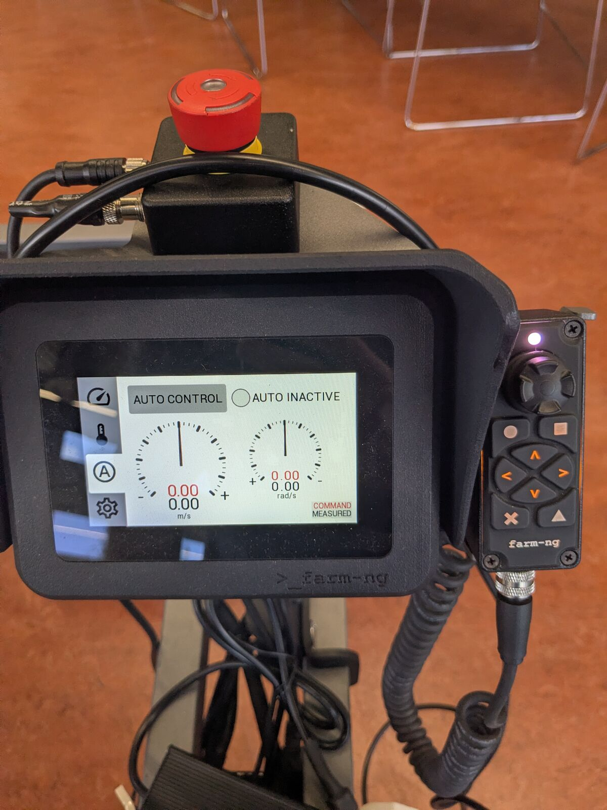
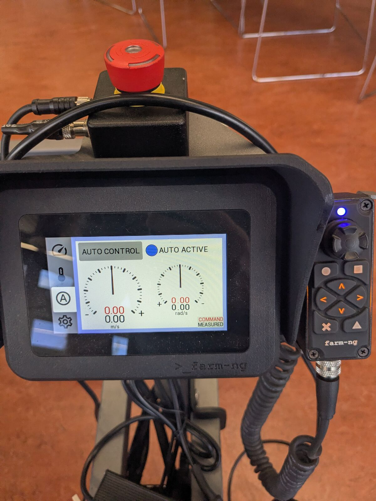

# Driving

Safety first: someone at the Amiga e-stop (red button above the pendant).

## Pendant mode

The **A** (auto) tab on the pendant selects who drives. Tap **AUTO CONTROL** to switch:

| AUTO INACTIVE: drive with the pendant | AUTO ACTIVE: ROS drives (gamepad, your own software) |
|---|---|
|  |  |

In AUTO ACTIVE the pendant shows the commanded and measured speed, which is useful to check that ROS commands arrive.

## Driving with the pendant

1. Set the pendant to AUTO INACTIVE.
2. Take the pendant off its holder (it stays connected by its cable) and walk alongside the robot.
3. Drive with the thumbstick. Releasing the thumbstick stops the robot.

## Gamepad teleop

1. Connect the gamepad to the Orin:
   - **Logitech F710**: plug the USB dongle into the Orin and set the switch on the back of the gamepad to **X**. In D mode the Orin has no working driver for it.
   - **PS4**: USB cable, or Bluetooth with a USB dongle (pair once, see [Installation](install.md#6-ps4-controller-bluetooth); after that, press the PS button to reconnect).

   Check on the Orin: `ls /dev/input/js*` shows a device.
2. Check that the Portenta is connected: `ls -l /dev/portenta` shows `-> ttyACM0`.
3. Set the pendant to AUTO ACTIVE (see [Pendant mode](#pendant-mode)).
4. In the [container](docker.md#entering-the-container):

   ```bash
   ros2 launch amiga_bringup teleop.launch.py
   ```

| Control | Function |
|---|---|
| L1 / LB (hold) | Deadman: the Amiga only moves while it is held |
| Left stick up/down | Forward/backward, 0.5 m/s at full stick |
| Right stick left/right | Turn, 0.5 rad/s at full stick |
| R1 / RB (hold, instead of L1 / LB) | Turbo: 1.0 m/s |

The launch terminal does not print commands.

## Testing without moving the Amiga

```bash
ros2 launch amiga_bringup teleop.launch.py agent:=false
```

In a second terminal, `ros2 topic echo /cmd_vel` while holding L1 / LB. Without the agent, nothing reaches the Amiga.

## Details

- Speeds and buttons are in [`src/amiga_bringup/config/ps4.yaml`](../src/amiga_bringup/config/ps4.yaml). Indices follow joy's `game_controller_node` (SDL mapping), so they are the same for the PS4 (USB and Bluetooth) and the F710 in X mode.
- The launch file starts the gamepad driver, `teleop_twist_joy` (publishes `/cmd_vel`) and the micro-ROS agent, which forwards `/cmd_vel` to the Portenta over `/dev/portenta`.
- Your own software can drive the Amiga the same way: publish `geometry_msgs/Twist` on `/cmd_vel` while the micro-ROS agent runs (for example `teleop.launch.py` with the gamepad not touched). Not tested yet.
