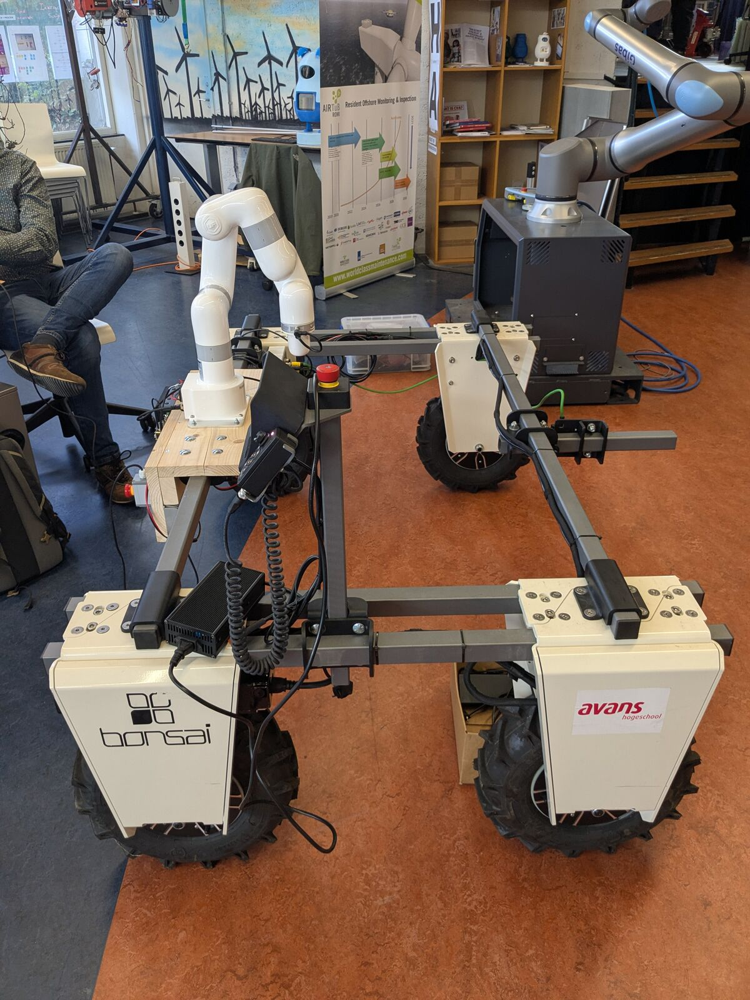
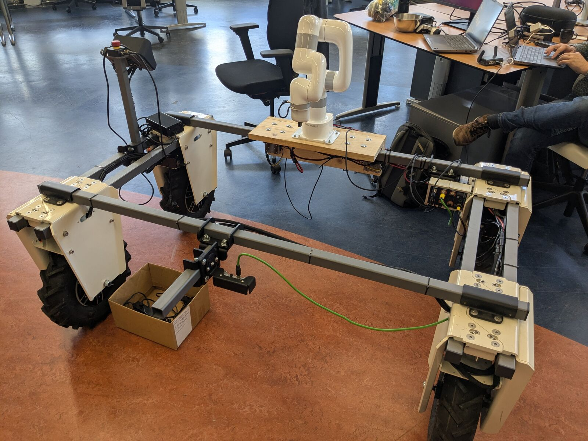
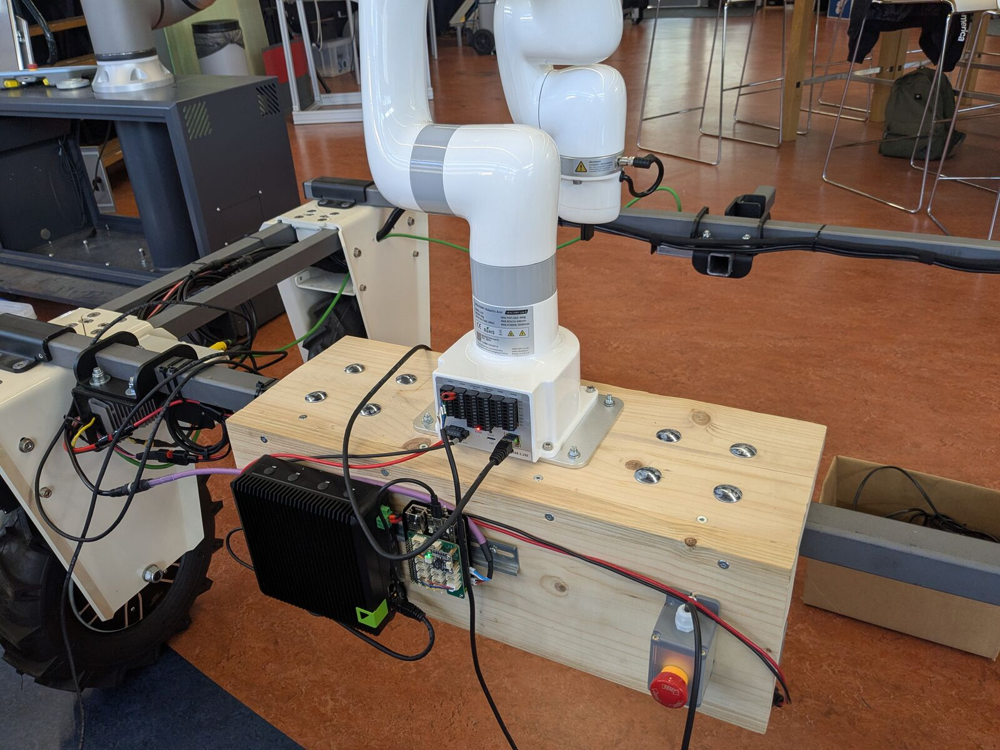
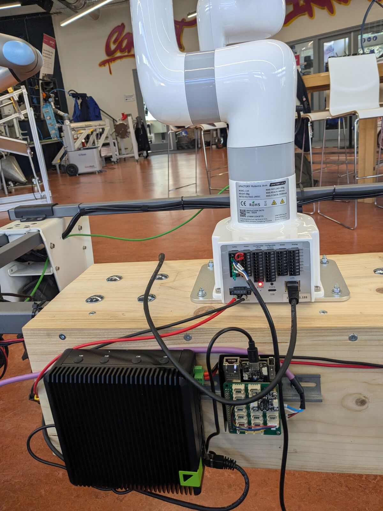
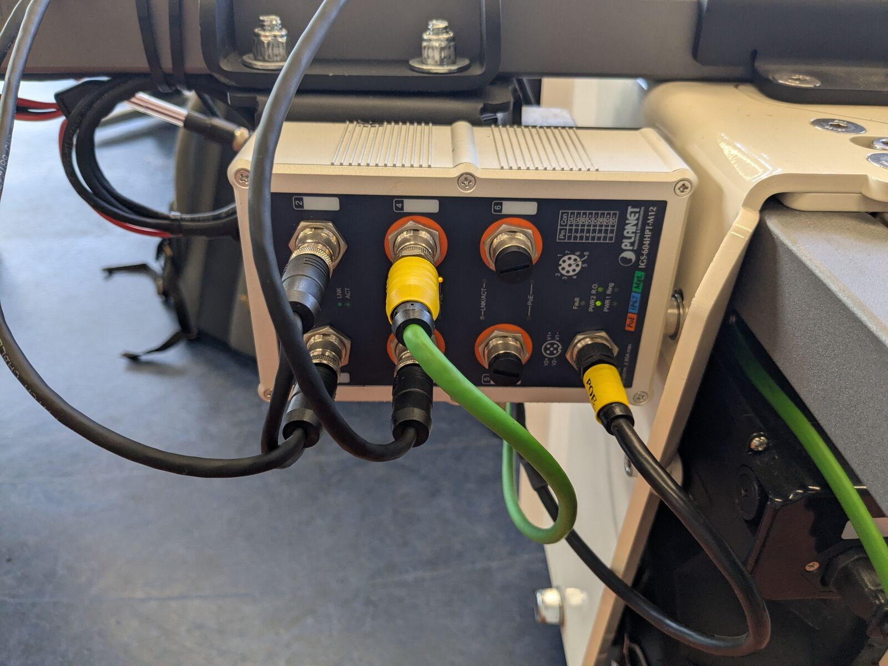
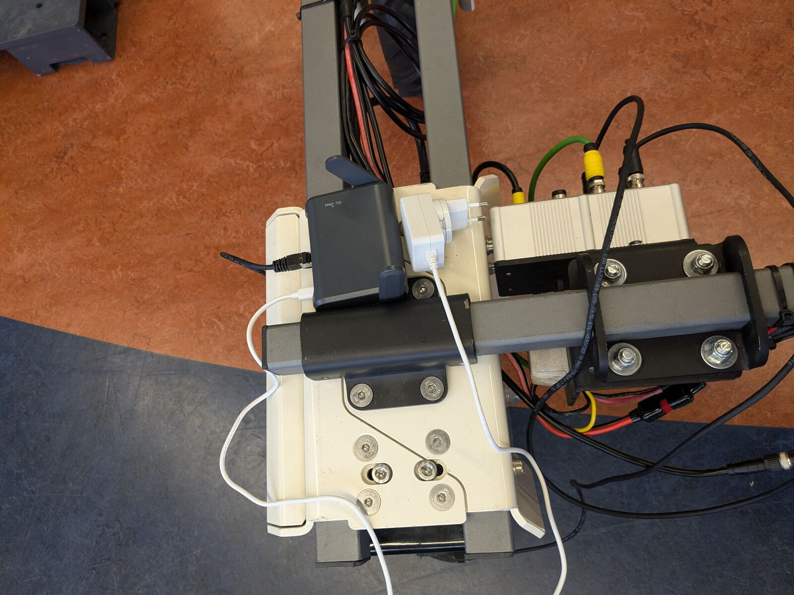

# Hardware

## Parts

| Part | Details |
|------|---------|
| Base | farm-ng Amiga, two batteries (one above each rear wheel), pendant with e-stop. Driven from ROS through its Portenta H7 via micro-ROS over USB (`/dev/portenta`) |
| Compute | NVIDIA Jetson Orin NX in a Seeed reComputer Robotics J401, Ubuntu 24.04 / JetPack 7.2 |
| Arm (optional) | UFactory Lite 6, firmware 2.8.2, upright on the wooden arm box, own e-stop |
| Camera (optional) | Luxonis OAK-D-W-PoE |
| Network | PLANET IGS-604HPT-M12 industrial PoE switch; GL.iNet travel router for WiFi |
| Gamepad | Logitech F710 (USB dongle, switch on X), or a PS4 controller over USB or Bluetooth (the Orin has no Bluetooth: needs a USB dongle) |

Everything runs on the Amiga batteries and starts when both battery keys are turned ON. See [Power and charging](power.md).

## Arm box

The wooden arm box sits on the Amiga rail. On top: the Lite 6. On the side: the Orin (black finned box), the Portenta board and the arm e-stop (cuts arm power only).

## Camera

The OAK-D is mounted on the crossbar and powered over Ethernet from the switch.

## Network

All Ethernet devices (Orin, arm controller, camera, router) connect to the PoE switch. The GL.iNet router gives WiFi access. See [Network and remote access](network.md).

## Arm platform in the robot model

The robot model is the Amiga from [amiga_description](https://github.com/Avans-Robotics/amiga_description) (a separate, public repo, pinned in the Dockerfile) with the arm platform from `src/amiga_arm_description` on top: two 575 x 190 x 25 mm planks at 90 degrees on the Amiga's rear cross tube, with the Lite 6 upright on the middle of the top plank, cable ports towards the vertical plank. The platform is turned 180°: the vertical plank hangs against the rear face of the tube, the top plank points to the front of the Amiga.
`platform_link` sits on the top edge of the cross tube that the vertical plank hangs against and is attached to the Amiga's `base_link` (centre of the wheel axles, at axle height). Its X axis points from the top plank towards the vertical plank.

### Adjusting the mount

The mount is set by the user of the robot: measure it and enter it in [`src/amiga_arm_description/config/arm_platform.yaml`](../src/amiga_arm_description/config/arm_platform.yaml). The values shipped are estimates. RViz, Gazebo and `moveit_real.launch.py` all read it, so there is one place to change. Units are metres and radians; frames are X forward, Y left, Z up.

| Key | Meaning |
|---|---|
| `platform.xyz`, `platform.rpy` | Pose of `platform_link` relative to the Amiga `base_link` |
| `platform.plank` | Plank size |
| `arm.xyz`, `arm.rpy` | Pose of the Lite 6 base (`link_base`) relative to `platform_link` |
| `camera.xyz`, `camera.rpy`, `camera.model` | Pose of the OAK-D (its base frame: on the front face, at the colour lens) relative to the Amiga `base_link`, used with `camera:=true` |
| `arm_sideways`, `xarm6`, `xarm6_sideways` | Simulation only: the Lite 6 mounted sideways (`sideways:=true`) and the xArm 6 option (`robot:=xarm6`); a sideways key's own `platform` replaces `platform` there, see [Simulation](simulation.md#picking-a-carrot) |

Examples for `platform`:

| Platform | `xyz` | `rpy` |
|---|---|---|
| Rear cross tube, turned 180°: vertical plank against the rear face (current) | `[-0.414, 0.0, 0.435]` | `[0.0, 0.0, 3.1416]` |
| Rear cross tube, vertical plank against the front face | `[-0.374, 0.0, 0.435]` | `[0.0, 0.0, 0.0]` |

Examples for `arm` (relative to the platform):

| Mount | `xyz` | `rpy` |
|---|---|---|
| Upright on the middle of the top plank, cable ports towards the vertical plank (current) | `[-0.07, 0.0, 0.025]` | `[0.0, 0.0, 3.1416]` |
| Upright on the middle of the top plank, cable ports away from the vertical plank | `[-0.07, 0.0, 0.025]` | `[0.0, 0.0, 0.0]` |
| Sideways on the vertical plank, pointing away from the top plank, cable ports up | `[0.025, 0.0, -0.095]` | `[0.0, 1.5708, 0.0]` |

For the upright mount, yaw (third `rpy` value) turns the arm around its base axis.

After changing the file:

1. Rebuild (only needed once per new file; with `--symlink-install` edits are picked up directly) and check in RViz with `ros2 launch amiga_arm_description display.launch.py`.
2. **Also set the mount angle in UFactory Studio** to match (90° sideways, 0° upright). The arm uses it for gravity compensation and collision detection; a wrong value makes it drift or trigger false collision stops.

How MoveIt gets the pose: see [Arm with MoveIt](arm-moveit.md#details-arm-pose-in-moveit).
