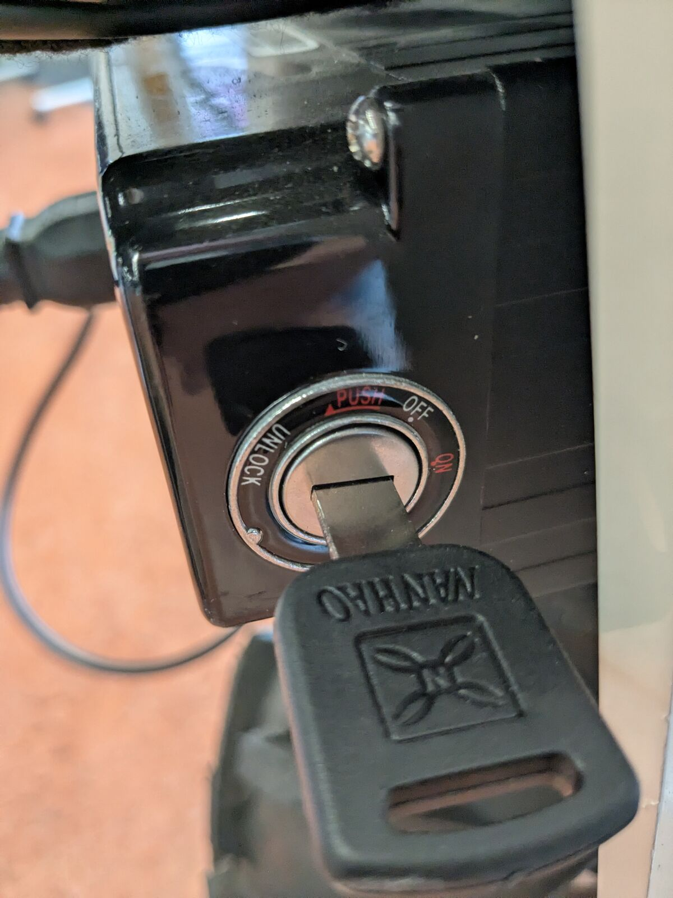
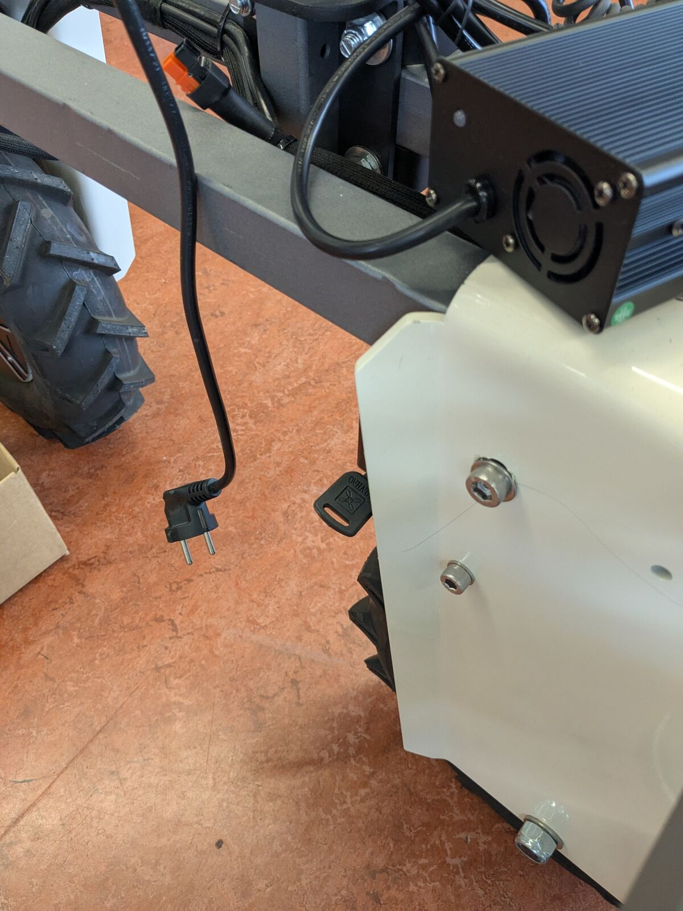
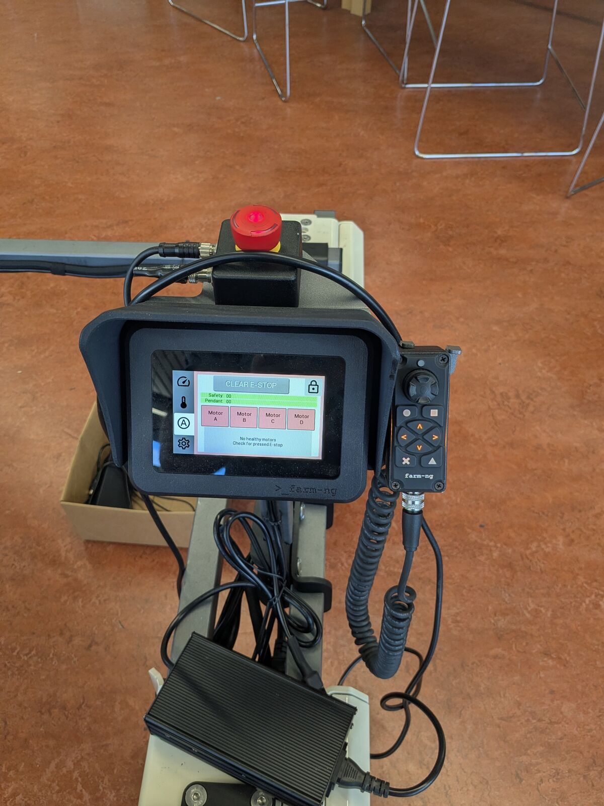
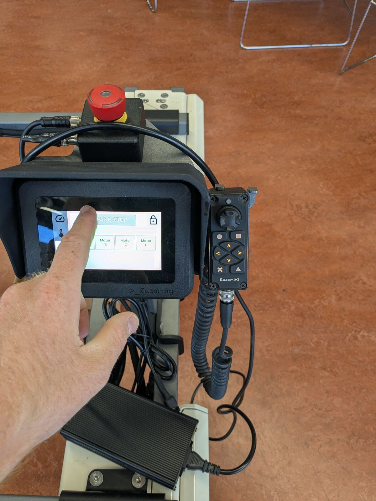
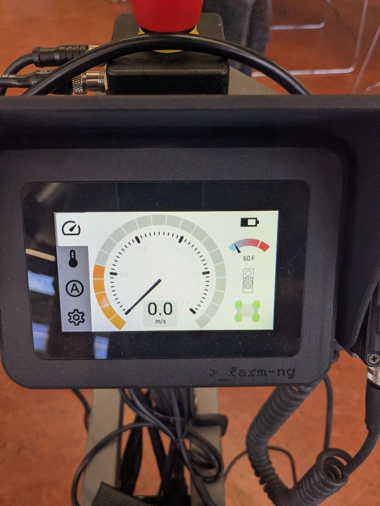
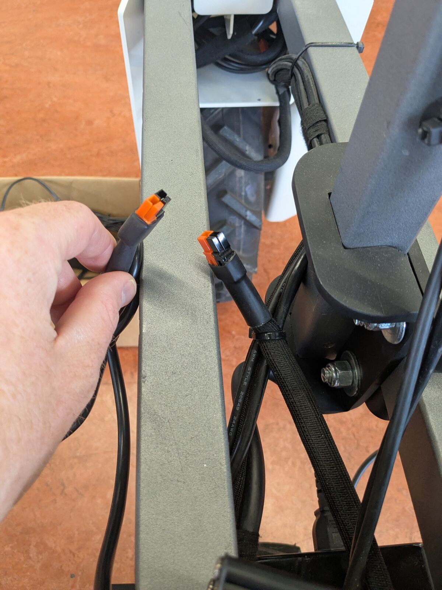
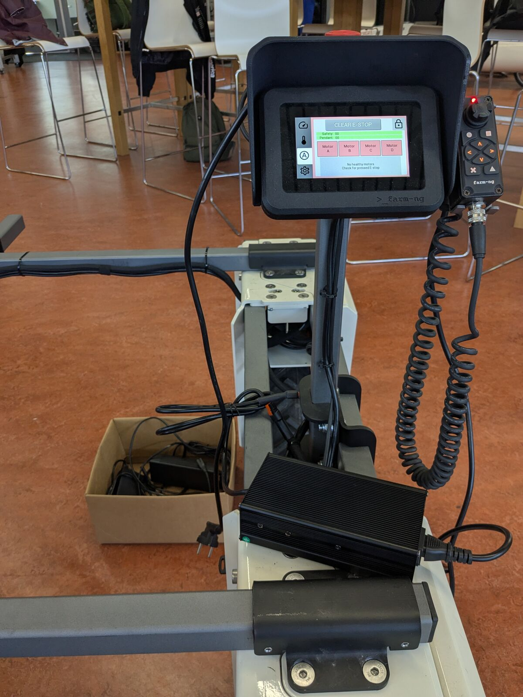

# Power and charging

Everything on the robot (Amiga motors, Orin, arm controller, PoE switch, router) runs on the two Amiga batteries. The batteries sit above the rear wheels, one on each side, each with its own key switch.

More from farm-ng: [Quick Start Guide](https://amiga.farm-ng.com/docs/amiga_quick_start/amiga-quick-start/), [Batteries and Charging](https://amiga.farm-ng.com/docs/hardware/charging/).

## Key switch



| Position | Meaning |
|---|---|
| ON | Battery switched on |
| OFF | Battery switched off |
| UNLOCK | Battery released from its fork, can be pulled out; the key can be removed |

The key sits under the frame, next to the battery:



**Both keys must always be in the same position**: both ON or both OFF, never one of each.

## Power on

1. Press the Amiga e-stop (red button above the pendant).
2. Turn both keys to ON. Everything starts: the Orin boots by itself, the arm controller, switch and router come up.
3. After the farm-ng logo, the pendant shows the START screen. Release the e-stop, wait a few seconds, tap START.
4. If the pendant shows **CLEAR E-STOP**, tap it:

   

   

5. The dashboard shows speed, battery level and temperature:

   

The arm is not ready yet after power on: it is enabled when you start MoveIt. See [Arm with MoveIt](arm-moveit.md).

## Power off

1. Shut the Orin down cleanly, over SSH or in a terminal on the RDP desktop:

   ```bash
   sudo shutdown now
   ```

   Wait until it is off (SSH and RDP drop, `ping 10.95.76.50` stops answering). Cutting the power while the Orin runs can corrupt its disk.
2. Turn both keys to OFF.

## E-stops

| E-stop | Where | What it stops |
|---|---|---|
| Amiga e-stop | Red button above the pendant | The Amiga motors |
| Arm e-stop | Red button on the wooden arm box | Power to the arm only |

After releasing the Amiga e-stop, tap CLEAR E-STOP on the pendant. After releasing the arm e-stop, the arm controller restarts: restart the MoveIt launch (see [Arm with MoveIt](arm-moveit.md)).

## Charging

Only use the farm-ng chargers that come with the robot. Charge in an open area, away from flammable materials, ideally on a concrete floor, between 0 and 45 °C.

### Quick charger (batteries stay in the robot)

The quick charger is mounted on the robot. It charges both batteries while they are in the robot.

1. Connect the orange connector of the charger to the orange connector on the robot:

   

2. Plug the charger into mains:

   

In our lab the robot keeps running while it is connected to the quick charger, so you can work on it on mains power. farm-ng does not document this.

### Battery chargers (batteries removed)

The two 2A battery chargers are in the cardboard box on the robot. They charge one battery each, outside the robot: about 5 hours for an empty battery. The LED on the charger is red while charging and green when the battery is full.

Charge both batteries to the same level before putting them back: never use batteries with different charge levels together.

### Removing and inserting a battery

1. Power off (see above): both keys to OFF.
2. Turn the key further to **UNLOCK** and remove the key.
3. Pull the battery out by its handle and place it carefully on the ground.

To insert: slide the battery in along the grooves under it, insert the key and turn it to OFF (locks the battery).
