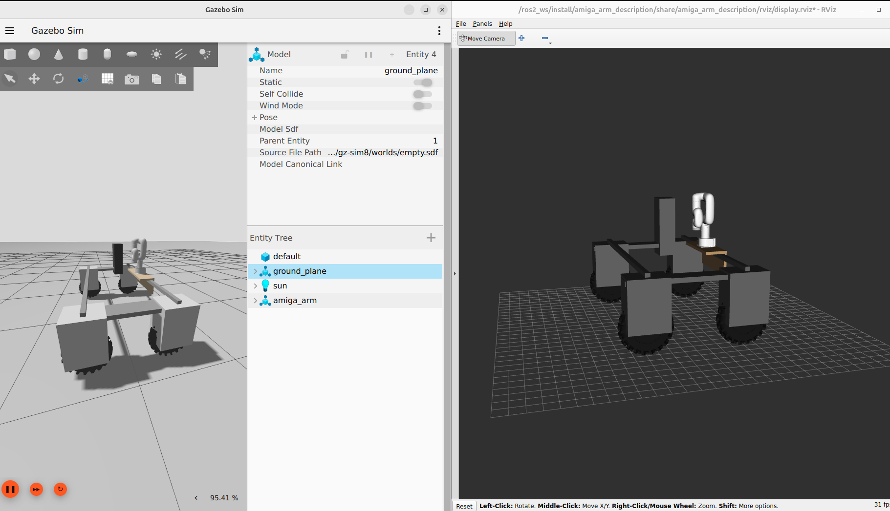

# Simulation

Drive the Amiga and move the Lite 6 in Gazebo on your own laptop. The simulated robot uses the same topics as the real one, so code you write against the simulation also runs on the robot.

## What you need

- A laptop with Ubuntu (24.04 tested) and [Docker](https://docs.docker.com/engine/install/ubuntu/).
- A GPU that drives your desktop (Intel or AMD with Mesa works). Without one, run Gazebo without its window, see [Without a GPU](#without-a-gpu).

## Starting

The first time, clone the repo and build the image (takes a while):

```bash
git clone https://github.com/Avans-Robotics/amiga_ros2.git
cd amiga_ros2/docker
docker compose -f compose.yaml -f compose.sim.yaml up -d --build
```

Then, every time:

```bash
cd amiga_ros2/docker
docker compose -f compose.yaml -f compose.sim.yaml up -d
xhost +local:
docker exec -it amiga-ros bash
# inside the container
colcon build --symlink-install --packages-select amiga_arm_description amiga_bringup
source install/setup.bash
ros2 launch amiga_arm_description gazebo.launch.py rviz:=true
```

Gazebo opens with the Amiga and the arm on an empty ground plane; RViz shows the robot and its frames.


 Open a second terminal in the container for the next steps (`docker exec -it amiga-ros bash`).

The simulation runs in ROS domain 1, so it does not mix with a real robot on the same network (domain 0).

## Driving

Keyboard:

```bash
ros2 run teleop_twist_keyboard teleop_twist_keyboard
```

Keep that terminal focused: `i` forward, `,` backward, `j` / `l` turn, `k` stop. `q` / `z` change the speed.

Gamepad (plugged into the laptop, see [Driving](driving.md) for the buttons): `ros2 launch amiga_bringup teleop.launch.py agent:=false`.

Your own code: publish `geometry_msgs/msg/Twist` on `/cmd_vel`, exactly as on the real robot:

```bash
ros2 topic pub -r 10 /cmd_vel geometry_msgs/msg/Twist "{linear: {x: 0.5}, angular: {z: 0.2}}"
```

The Amiga keeps the last command until a new one arrives: send a zero Twist to stop.

## Moving the arm

The arm runs the `lite6_traj_controller` (joint trajectory controller). Example: move all six joints in 2 seconds:

```bash
ros2 action send_goal /lite6_traj_controller/follow_joint_trajectory control_msgs/action/FollowJointTrajectory \
  "{trajectory: {joint_names: [joint1, joint2, joint3, joint4, joint5, joint6], points: [{positions: [0.3, 0.2, 0.3, 0.0, 0.0, 0.0], time_from_start: {sec: 2}}]}}"
```

## Topics

| Topic | Type | |
|---|---|---|
| `/cmd_vel` | `geometry_msgs/msg/Twist` | Drive command (in) |
| `/wheel/odometry` | `nav_msgs/msg/Odometry` | Wheel odometry, frame `odom` to `base_footprint` |
| `/joint_states` | `sensor_msgs/msg/JointState` | Wheel and arm joints |
| `/tf` | `tf2_msgs/msg/TFMessage` | Includes `odom` to `base_footprint` from the wheel odometry |
| `/lite6_traj_controller/follow_joint_trajectory` | `control_msgs/action/FollowJointTrajectory` | Arm motion (action) |

Running your own localization (an EKF) that publishes `odom` to `base_footprint`? Start with `publish_odom_tf:=false`.

## Good to know

- **Wheel odometry drifts when turning.** The Amiga is a skid steer: its wheels slide sideways when it turns. With the arm on the back, it turns around a point near the rear axle instead of its centre, while the wheel odometry assumes the centre. Driving straight is accurate. The real robot behaves the same way, which is why localization fuses the odometry with an IMU or GNSS.
- Wheel friction is a setting in the Amiga model ([amiga_description](https://github.com/Avans-Robotics/amiga_description), `amiga.gazebo.xacro`); it is not tuned against the real robot yet.
- There are no crops, sensors or camera in the simulation yet.

## Without a GPU

Run Gazebo without its window and watch the robot in RViz instead:

```bash
ros2 launch amiga_arm_description gazebo.launch.py gz_args:='-s -r empty.sdf' rviz:=true
```

## Launch files

| Launch file | What it does |
|---|---|
| `gazebo.launch.py` | Gazebo: the Amiga on `/cmd_vel`, the Lite 6 with its trajectory controller. Arguments `rviz`, `publish_odom_tf`, `gz_args` |
| `display.launch.py` | RViz with joint sliders, the Amiga fixed in place. `use_real_arm:=true` mirrors the real arm from `/ufactory/joint_states` instead |
| `moveit_real.launch.py` | MoveIt + driver for the real arm (Orin only) |

## For developers

`src/` is mounted into the container, so edits on the host are picked up after a `colcon build` (no image rebuild). The Amiga model (amiga_description) comes with the image, at the tag pinned in the Dockerfile.

The robot model is `amiga_arm.urdf.xacro` with `fixed:=false gazebo:=true`; the Gazebo drive comes from amiga_description's `amiga.gazebo.xacro`. xarm's `lite6_controllers.yaml` is loaded by its xacro; the arm controllers are `joint_state_broadcaster` and `lite6_traj_controller`.
